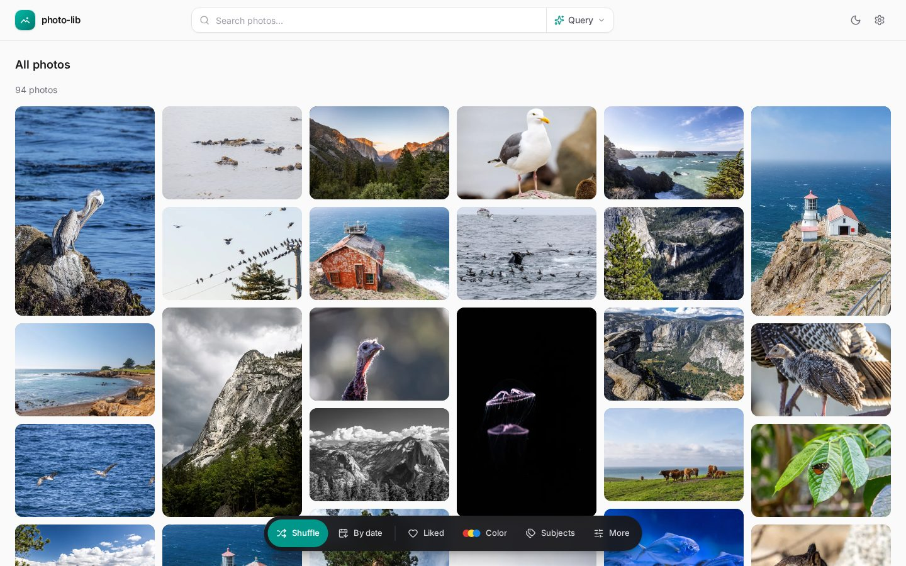
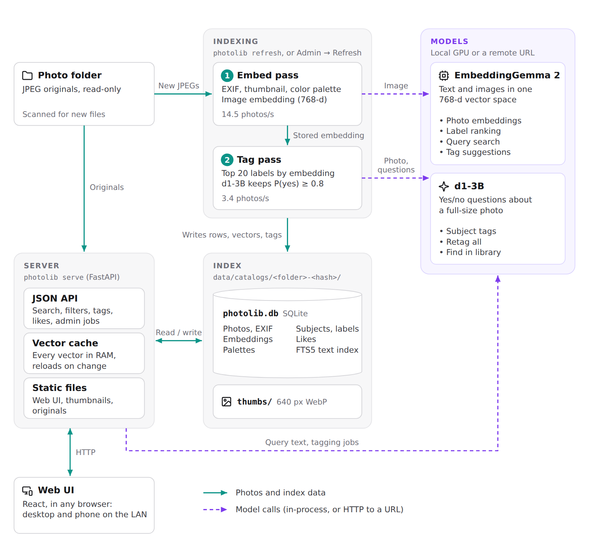

# photo-lib

A single-user, local photo catalog you can browse from any device on your network. Point it at a
folder of JPEGs. It stores EXIF data, thumbnails, color palettes,
[EmbeddingGemma 2](https://huggingface.co/google/embeddinggemma-2) image embeddings and subject tags
from [LiquidAI d1-3B](https://huggingface.co/LiquidAI/d1-3B) in one SQLite file per photo folder, then
serves a responsive web UI with:

- **Query search**: describe what's in the photo ("bird in flight").
- **Subject tags**: EmbeddingGemma proposes labels from a ~150-label vocabulary, and d1-3B confirms
  them by looking at the full-resolution photo.
- **Your own tags**: type a tag on any photo, and apply a new one to the rest of the library in one
  click (EmbeddingGemma shortlists photos, d1 confirms each one).
- **Filters**: subjects, liked, camera, lens, ISO, aperture, focal length, date.
- **Metadata search, search by color, find similar, double-tap to like.**

There are no accounts and nothing leaves the machine.



**Documentation: <https://jbencina.github.io/photo-lab/>**

## Requirements

- Linux or WSL2, [uv](https://docs.astral.sh/uv/), and Node.js 20+ to build the web UI.
- An NVIDIA GPU with about 9 GB of free VRAM for tagging (search alone needs about 2 GB). Without one,
  everything runs on the CPU, but tagging a large library becomes impractical.
- About 8.5 GB of disk for the model weights.

Either model can also run on another machine behind a URL; see
[Where the models run](https://jbencina.github.io/photo-lab/models).

## Quick start

```bash
# 1. model weights (once)
uvx hf download google/embeddinggemma-2 --local-dir models/embeddinggemma-2
uvx hf download LiquidAI/d1-3B --local-dir models/d1-3B

# 2. python env (the `local` extra is PyTorch + transformers, to run the models on this machine)
uv sync --extra local

# 3. web UI
cd frontend && npm install && npm run build && cd ..

# 4. index a folder and serve
uv run photolib catalog set /path/to/photos --embedding-model local --decision-model local
uv run photolib serve --embedding-model local --decision-model local
```

Open <http://localhost:8000>, or `http://<this machine's IP>:8000` from your phone. Your photo folder
is only ever read. See [Getting started](https://jbencina.github.io/photo-lab/getting-started) for
the details, and [Phone and tablet](https://jbencina.github.io/photo-lab/guide/phone) for WSL2
networking.

## How it works

<picture>
  <source media="(prefers-color-scheme: dark)" srcset="docs/static/img/system-overview-dark.png">
  
</picture>

**Indexing** reads your photos and writes the index. The embed pass stores EXIF data, a thumbnail, a
color palette and an EmbeddingGemma 2 image embedding for each new JPEG. The tag pass then ranks the
labels against that stored embedding and asks d1-3B about the 20 best, keeping those it is at least
80% sure of. The **server** reads and writes the index, keeps every vector in memory for search, calls
EmbeddingGemma for Query searches and d1-3B for tagging jobs, and serves the web UI, thumbnails and
originals.

On an RTX 4080, indexing runs at about 14.5 photos/s and tagging at about 3.4 photos/s: a
25,000-photo library takes about 30 minutes to index and 2 hours to tag.

## Documentation

- [Getting started](https://jbencina.github.io/photo-lab/getting-started): install, first catalog,
  requirements.
- [Using the web UI](https://jbencina.github.io/photo-lab/guide/library): library and search, filters,
  the photo viewer, tags, Admin, phones.
- [Catalogs](https://jbencina.github.io/photo-lab/catalogs) and
  [Where the models run](https://jbencina.github.io/photo-lab/models).
- [CLI](https://jbencina.github.io/photo-lab/cli) and [API](https://jbencina.github.io/photo-lab/api)
  reference.
- [How it works](https://jbencina.github.io/photo-lab/internals/overview): search, subject tagging,
  manual tags, data layout.
- [Development](https://jbencina.github.io/photo-lab/development) and
  [Limitations](https://jbencina.github.io/photo-lab/limitations).

The site's source is in `docs/` (pages in `docs/content/`); `cd docs && npm install && npm start` serves it locally.

## Limitations

JPEG only (no HEIC, RAW or video). No authentication: anyone on your LAN who can reach the port can
browse, tag and purge, so don't expose it to the internet. See
[Limitations](https://jbencina.github.io/photo-lab/limitations) for the rest.

## License

photo-lib is licensed under the [GNU General Public License v3.0](LICENSE) or later.

The models have their own licenses. d1-3B is released under the LFM Open License v1.0, which is not an
OSI open-source license: commercial use is only licensed for entities under US$10M annual revenue.
photo-lib downloads the weights rather than shipping them. See
[Model license](https://jbencina.github.io/photo-lab/getting-started#model-license).
